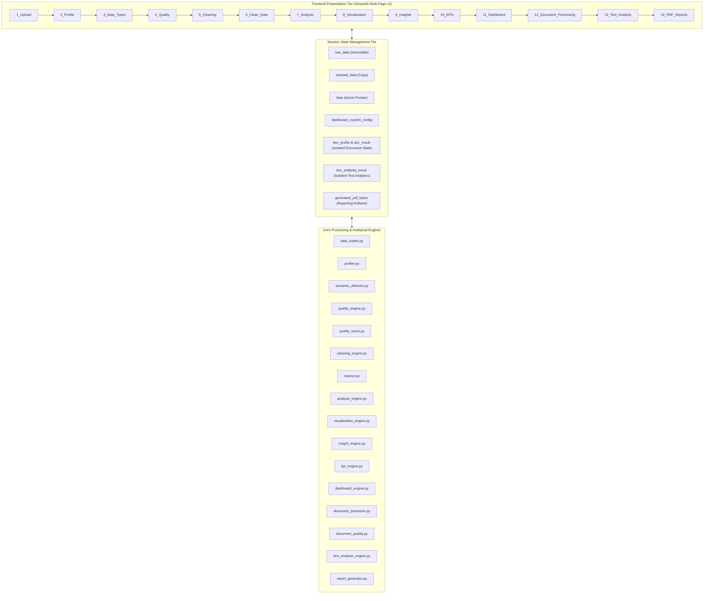
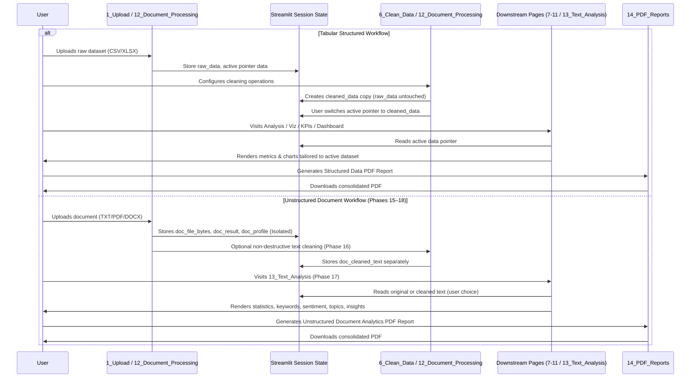

# AutoDataIQ: An Intelligent Framework for Automated Data Quality Assessment and Adaptive Data Analysis

**Master of Computer Applications (MCA) Final Project Report & Comprehensive Documentation**

---

## Table of Contents

1. [Project Title & Abstract](#1-project-title--abstract)
2. [Problem Statement & Objectives](#2-problem-statement--objectives)
3. [Existing System vs. Proposed System](#3-existing-system-vs-proposed-system)
4. [System Architecture & Methodology](#4-system-architecture--methodology)
5. [Detailed Module Specifications](#5-detailed-module-specifications)
6. [Streamlit User Interface & Multi-Page Workflow](#6-streamlit-user-interface--multi-page-workflow)
7. [Tools, Libraries & Technologies Used](#7-tools-libraries--technologies-used)
8. [Hardware & Software System Requirements](#8-hardware--software-system-requirements)
9. [Installation, Configuration & Execution Guide](#9-installation-configuration--execution-guide)
10. [Testing Methodology & Comprehensive Test Results](#10-testing-methodology--comprehensive-test-results)
11. [Data Protection, Reproducibility & Ethical Considerations](#11-data-protection-reproducibility--ethical-considerations)
12. [Limitations & Future Scope](#12-limitations--future-scope)
13. [Conclusion & Project Readiness](#13-conclusion--project-readiness)

---

## 1. Project Title & Abstract

### Project Title
**AutoDataIQ: An Intelligent Framework for Automated Data Quality Assessment and Adaptive Data Analysis**

### Abstract
In contemporary data-driven organizations, data quality issues—such as missing values, duplicate entries, schema inconsistencies, format anomalies, and statistical outliers—compromise analytics pipelines and undermine decision-making. Conventional Exploratory Data Analysis (EDA) and data cleansing workflows remain predominantly manual, error-prone, and time-consuming, requiring domain experts to write repetitive boilerplate code.

**AutoDataIQ** is an end-to-end, modular, and transparent data quality intelligence and automated analytics system developed in Python and Streamlit. The application ingests structured tabular datasets (CSV, XLSX, XLS), profiles their structural characteristics, performs multi-signal rule-based semantic data-type detection, evaluates data quality across six standardized dimensions, calculates an overall quality score (0–100), provides actionable cleaning recommendations, executes user-directed transformations on an isolated copy with strict immutability of raw data, dynamically performs adaptive exploratory analysis, recommends interactive 2D Plotly visualizations, extracts prioritized analytical insights with empirical evidence, detects domain-relevant KPIs with explicit mathematical formulas, and compiles an interactive, customizable executive dashboard.

AutoDataIQ operates entirely deterministically and locally without relying on external commercial cloud APIs or opaque "black-box" models, guaranteeing complete data privacy, transparent reasoning, and algorithmic reproducibility.

---

## 2. Problem Statement & Objectives

### Problem Statement
Modern data analysis teams spend up to 80% of their operational time preparing, validating, and cleaning raw datasets before performing productive analysis. Key challenges in modern data engineering include:
1. **Inefficient Manual Profiling:** Writing ad-hoc profiling scripts repeatedly for every incoming dataset.
2. **Superficial Data-Type Detection:** Traditional frameworks only classify data into primitive machine types (`object`, `int64`, `float64`), failing to recognize semantic roles such as identifiers, temporal markers, categorical classes, or text notes.
3. **Lack of Standardized Quality Measurement:** Absence of a normalized, multidimensional quality score to benchmark data hygiene across datasets.
4. **Irreversible or Unaudited Data Mutation:** Typical cleaning scripts overwrite datasets in-place without audit logs or raw data preservation.
5. **Static Reporting:** Pre-canned dashboards that cannot be tailored to specific executive or analytical presentations without code alterations.

### Objectives
The primary objectives of AutoDataIQ are:
- **Automated Data Ingestion & Validation:** Provide robust, in-memory loading of structured CSV and Excel files with graceful handling of corrupted or empty files.
- **Deep Semantic Inference:** Implement multi-signal heuristics to classify columns into six semantic types (Numerical, Categorical, Date/Datetime, Boolean, Identifier, Text) with confidence ratings and reasoning.
- **Holistic Quality Assessment & Scoring:** Compute a 0–100 Data Quality Score across six dimensions (Completeness, Uniqueness, Consistency, Validity, Structural Quality, and Numerical Reliability).
- **Rule-Based Cleaning Recommendations:** Provide actionable suggestions answering *what* to clean, *why*, *which method* to use, and *expected impact*.
- **Safe, Audited Cleaning Execution:** Enable interactive transformation execution with a transparent audit log and CSV/Excel export, while enforcing 100% raw data immutability.
- **Adaptive Exploratory Analysis:** Dynamically activate statistical modules tailored to the dataset's specific column composition.
- **Automated Visual Recommendations:** Recommend and render interactive Plotly visualizations based on column types and cardinality constraints.
- **Prioritized Insight Discovery:** Extract and rank key statistical findings with concrete supporting evidence and observational caveats.
- **Domain KPI Detection:** Automatically detect relevant quantitative metrics with transparent mathematical formulas and non-summable safeguards.
- **Executive Dashboard & Customization:** Provide a consolidated dashboard synthesizing KPIs, visualizations, insights, and quality health, with interactive section reordering, card toggles, and artifact downloads.

---

## 3. Existing System vs. Proposed System

| Feature / Dimension | Existing Typical Systems (Pandas-Profiling, Manual EDA) | Proposed AutoDataIQ Framework |
| :--- | :--- | :--- |
| **Data Ingestion** | Requires code scripts; basic error messages for invalid formats. | Multi-format web UI (CSV/XLSX/XLS) with instant validation and error recovery. |
| **Data Type Detection** | Primitive Pandas data types (`object`, `float64`, `int64`). | Multi-signal semantic detection: Numerical, Categorical, Date, Boolean, ID, Text. |
| **Quality Assessment** | Ad-hoc checks; no composite, standardized scoring. | 6-dimension mathematical score (0–100) and formal rating (*Excellent* to *Critical*). |
| **Cleaning Advice** | Generic documentation or manual trial-and-error. | Rule-based recommendations categorized by priority (*High*, *Medium*, *Low*, *Info*). |
| **Data Cleaning Execution** | In-place mutations; high risk of raw data loss; no audit trail. | Isolated DataFrame copy, audit log, IQR outlier clipping, strict raw immutability. |
| **Downstream Switching** | Manual variable reassignment in Python notebooks. | Native active dataset switcher (*Original* vs. *Cleaned*) reflected across all pages. |
| **Visualization** | Requires manual matplotlib/seaborn configuration. | Automated selection and rendering of interactive 2D Plotly charts. |
| **Insights & KPIs** | Manual human observation and spreadsheet formula writing. | Automated insight prioritization with numerical evidence and automatic KPI derivation. |
| **Executive Presentation** | Static HTML exports without layout rearrangement. | Dynamic executive dashboard with arrangement presets, item toggles, and exports. |
| **Privacy & Dependability** | Some cloud tools send data to third-party LLMs. | 100% local, deterministic, and read-only without external API calls. |

---

## 4. System Architecture & Methodology

AutoDataIQ follows a decoupled, three-tier modular architecture:



### Key Workflow Phases:
1. **Ingestion & Profiling:** Ingest file into memory, initialize session state, profile dimensions and distributions.
2. **Semantic Understanding:** Examine column names, unique ratios, parseability, and value distributions to infer semantic types.
3. **Hygiene Assessment:** Identify 11 defect types and evaluate the 6-dimension Quality Score.
4. **Prescription & Transformation:** Formulate cleaning recommendations; user selectively applies transformations to a dedicated copy.
5. **Adaptive Exploration:** Dispatch numerical, categorical, temporal, and relational analysis modules dynamically.
6. **Visual & Analytical Synthesis:** Render Plotly figures, rank insights by effect size, and derive KPIs.
7. **Executive Dashboard & Customization:** Aggregate findings into an executive view with custom reordering, toggles, and export options.

---

## 5. Detailed Module Specifications

All core logic resides within the `modules/` directory as pure, reusable Python modules:

### 5.1 `data_loader.py` (Phase 1)
- **Purpose:** Ingests tabular data files from Streamlit `UploadedFile` or `io.BytesIO`.
- **Supported Formats:** CSV, XLSX, XLS.
- **Validations:** File size checks, empty byte streams, encoding detection (UTF-8, Latin-1 fallback), corrupted spreadsheet recovery.
- **Key Function:** `load_dataset(file) -> pd.DataFrame`

### 5.2 `profiler.py` (Phase 2)
- **Purpose:** Computes dataset-level and column-level structural profiles.
- **Key Functions:**
  - `profile_dataset(df)`: Returns row count, column count, memory usage, missing cells count and percentage, duplicate rows count and percentage.
  - `profile_columns(df)`: Generates tabular profile containing column names, data types, null counts, null percentages, unique counts, and sample values.
  - `profile_numerical_columns(df)`: Computes mean, standard deviation, min, 25%, median, 75%, max, skewness, and kurtosis.
  - `profile_categorical_columns(df)`: Computes distinct count, top frequent category, frequency, and mode percentage.

### 5.3 `semantic_detector.py` (Phase 3)
- **Purpose:** Performs multi-signal classification beyond primitive Pandas dtypes.
- **Target Types:**
  - `Numerical`: Numeric values representing quantities, metrics, or physical amounts.
  - `Categorical`: Low-to-moderate cardinality discrete groupings or classes.
  - `Date/Datetime`: Calendar dates, timestamps, or temporal records.
  - `Boolean`: Binary true/false, yes/no, 0/1 indicator flags.
  - `Identifier`: High-cardinality unique keys, primary keys, transaction IDs.
  - `Text`: Unstructured or free-form text strings, descriptions, or comments.
- **Key Function:** `detect_semantic_types(df) -> pd.DataFrame`

### 5.4 `quality_engine.py` (Phase 4)
- **Purpose:** Detects data hygiene anomalies and quality defects in a strictly read-only manner.
- **Defects Detected:**
  1. Missing values and blank cells
  2. Completely empty columns
  3. Exact duplicate rows
  4. Constant columns (zero variance)
  5. Near-constant columns (dominant value > 95%)
  6. High-cardinality categorical fields
  7. Numerical data-type inconsistencies (strings in numeric columns)
  8. Invalid domain values (negative values where prohibited)
  9. Categorical casing inconsistencies (e.g. "Sales", "sales", "SALES")
  10. Boolean formatting variants (e.g. mixed True/False, 1/0, "Y"/"N")
  11. Statistical outliers (IQR method: $Q_1 - 1.5 \times \text{IQR}$, $Q_3 + 1.5 \times \text{IQR}$)
- **Key Function:** `analyze_data_quality(df, semantic_types_df) -> dict`

### 5.5 `quality_score.py` (Phase 5)
- **Purpose:** Evaluates quantitative Data Quality Score on a 0–100 scale across six weighted dimensions.
- **Mathematical Dimension Weights:**
  $$\text{Quality Score} = 0.25 C + 0.15 U + 0.20 S_{\text{cons}} + 0.20 V + 0.10 Q_{\text{struct}} + 0.10 R_{\text{num}}$$
  - **Completeness ($C$, 25%):** Penalized by cell missingness percentage.
  - **Uniqueness ($U$, 15%):** Penalized by row duplication percentage.
  - **Consistency ($S_{\text{cons}}$, 20%):** Evaluates case consistency and boolean format standardization.
  - **Validity ($V$, 20%):** Penalized by type conversion errors and unparseable data.
  - **Structural Quality ($Q_{\text{struct}}$, 10%):** Evaluates empty, constant, and near-constant columns.
  - **Numerical Reliability ($R_{\text{num}}$, 10%):** Penalized by extreme statistical outliers.
- **Rating Scale:**
  - $\ge 90$: **Excellent**
  - $75 - 89.9$: **Good**
  - $60 - 74.9$: **Fair**
  - $40 - 59.9$: **Poor**
  - $< 40$: **Critical**
- **Key Function:** `calculate_quality_score(df, quality_report) -> dict`

### 5.6 `cleaning_engine.py` (Phase 6)
- **Purpose:** Formulates rule-based, actionable data cleaning recommendations without mutating data.
- **Output:** Recommendation table detailing *Priority* (High, Medium, Low, Info), *Category*, *Column*, *Recommended Action*, *Method*, and *Reason*.
- **Key Function:** `generate_cleaning_recommendations(df, quality_report, semantic_types_df) -> dict`

### 5.7 `cleaner.py` (Phase 11)
- **Purpose:** Executes user-configured transformations on an isolated copy of the raw DataFrame.
- **Operations:**
  - Empty column dropping (explicit selection)
  - Duplicate row removal (preserves first occurrence)
  - Missing value imputation (mean, median, mode, constant)
  - Safe data-type conversions with transparent coercion tracking
  - Text standardization (whitespace trimming and title/lower/upper casing)
  - Outlier handling (IQR clipping/winsorization preserving row count)
- **Key Function:** `apply_cleaning_pipeline(raw_df, config) -> (cleaned_df, logs, summary)`

### 5.8 `analysis_engine.py` (Phase 7)
- **Purpose:** Dynamically activates relevant exploratory data analysis modules.
- **Modules Dispatched:**
  - Numerical Statistics
  - Categorical Frequencies
  - Temporal Date Distributions & Spans
  - Boolean Proportions
  - Identifier Key Analysis
  - Pearson Correlation Analysis ($r \ge 0.5$)
  - Categorical Group Comparisons (Groupby Mean/Median)
  - Time-Series Monthly Trends
- **Key Function:** `run_adaptive_analysis(df, semantic_types_df) -> dict`

### 5.9 `visualization_engine.py` (Phase 8)
- **Purpose:** Recommends and renders interactive 2D Plotly figures tailored to column semantics.
- **Supported Visualizations:**
  - Histograms with KDE curves
  - Five-number summary Box Plots
  - Top-N Categorical Bar Charts (capped at 10 to avoid overcrowding)
  - Bivariate Scatter Plots
  - Pearson Correlation Heatmaps
  - Time-Series Line Charts
  - Categorical Group Comparison Bar Charts
  - Boolean Proportion Bar Charts
- **Key Functions:** `get_visualization_plan(df)`, `generate_histogram()`, `generate_line_chart()`, etc.

### 5.10 `insight_engine.py` (Phase 9)
- **Purpose:** Uncovers statistically significant patterns, anomalies, and relationships.
- **Ranking Logic:** Sorts findings into High, Medium, and Low priorities based on effect size, correlation strength ($|r| \ge 0.7$ for High), category dominance ($\ge 70\%$), and data quality severity.
- **Key Function:** `generate_insights(df, semantic_types_df, quality_report, quality_score_result) -> dict`

### 5.11 `kpi_engine.py` (Phase 10)
- **Purpose:** Automatically detects quantitative indicators across Overview, Potential Business, Statistical Numerical, Categorical, and Temporal dimensions.
- **Identifier Safeguards:** Strictly excludes ID fields from arithmetic aggregations and prevents meaningless operations (e.g. no "Sum of Age").
- **Key Function:** `detect_kpis(df, semantic_types_df) -> dict`

### 5.12 `dashboard_engine.py` (Phases 12 & 13)
- **Purpose:** Aggregates and customizes executive dashboard components.
- **Capabilities:**
  - Automated curation of top 4–6 KPIs, 2–4 diverse visualizations, and 3–5 highlighted insights.
  - Calculation caching by dataset signature to prevent redundant re-computation.
  - Interactive customization: filtering specific KPI cards, visualizations, and insights.
  - Section reordering via executive presets or custom multiselect.
  - Reset mechanism restoring the automatic baseline.
  - Artifact export: CSV summaries and standalone interactive HTML Plotly charts.
- **Key Functions:** `generate_dashboard_data()`, `apply_dashboard_customization()`, `get_default_customization_config()`, `filter_customization_for_dataset()`.

### 5.13 `document_processor.py` (Phase 15)
- **Purpose:** Ingests and extracts selectable text from unstructured documents (TXT, PDF, and DOCX) and computes comprehensive document profiling metrics.
- **Supported Formats:**
  - `TXT`: Plain text files decoded with robust multi-encoding fallbacks (`utf-8-sig`, `utf-8`, `latin-1`, `cp1252`).
  - `PDF`: Text-based Portable Document Format files parsed using `pypdf.PdfReader` with page-by-page extraction and page counting.
  - `DOCX`: Microsoft Word XML packages parsed using `docx.Document` with paragraph and table extraction and paragraph counting.
- **Error Handling & Scanned Detection:**
  - Empty file detection (0-byte rejection).
  - Corrupt or malformed PDF/DOCX detection with user-friendly diagnostics.
  - Image-only / scanned PDF detection: identifies 0 selectable characters and informs the user that OCR is not supported in this phase.
- **Profiling Metrics:** File name, file size, character counts (total and non-whitespace), word counts, line counts, PDF page counts (explicitly `None` for TXT/DOCX), DOCX paragraph counts (explicitly `None` for TXT/PDF), average word length, and truncated readable text preview.
- **Strict Isolation:** Operates using dedicated session-state keys (`doc_file_bytes`, `doc_filename`, `doc_extraction_result`, `doc_profile`), ensuring structured tabular DataFrames (`raw_data`, `cleaned_data`) are never mutated or coupled.
- **Key Functions:** `detect_document_type()`, `extract_document_text()`, `profile_document()`, `format_file_size()`.

### 5.14 `document_quality.py` (Phase 16)
- **Purpose:** Performs rule-based quality inspection and non-destructive text cleaning previews on extracted document text.
- **Quality Checks:** Identifies empty content, leading/trailing whitespace, excessive blank line runs ($\ge 3$), repeated complete lines, repeated paragraphs, high proportions of non-printable characters, and very short extractions.
- **Non-Destructive Cleaning:** Supports whitespace trimming, line ending normalization (`\r\n` to `\n`), blank line collapsing, and deduplication of repeated lines without mutating the original extracted text.
- **Key Functions:** `assess_document_quality()`, `clean_document_text()`, `build_cleaning_preview()`, `initialize_document_cleaning_state()`, `reset_document_cleaning_state()`.

### 5.15 `text_analysis_engine.py` (Phase 17)
- **Purpose:** Delivers comprehensive, explainable rule-based text analytics on unstructured document text.
- **Capabilities:**
  - **Text Statistics:** Calculates total characters, non-whitespace characters, words, sentences, paragraphs, average word length, average sentence length, and top raw vocabulary words.
  - **Keyword Frequency Analysis:** Normalizes casing, strips boundary punctuation, eliminates common English stop-words (*the, is, are, and, was, etc.*), and returns top 10–15 meaningful keywords with occurrence counts and percentages.
  - **Rule-Based Sentiment Classification:** Evaluates sentences against curated positive and negative lexicons; classifies text into *Positive*, *Negative*, or *Neutral* with complete sentence-by-sentence evidence, score formulas, and explicit limitation disclaimers.
  - **Domain Topic Identification:** Maps content against 7 business domains (*Delivery and Shipping*, *Billing and Payment*, *Product Quality*, *Customer Support*, *Mobile Application*, *Website Experience*, and *General Feedback*) using keyword taxonomies with matched terms and excerpt evidence.
  - **Rule-Based Insight Generation:** Automatically synthesizes findings into prioritized insights (*High*, *Medium*, *Low*), each including a clear title, plain-language explanation, supporting numerical evidence, category tag, and priority rating.
- **Key Functions:** `calculate_text_statistics()`, `analyze_keyword_frequency()`, `analyze_sentiment_rules()`, `identify_topics()`, `generate_text_insights()`, `run_text_analysis()`, `get_analyzable_text()`, `clear_document_analysis_state()`.

### 5.16 `report_generator.py` (Phase 18)
- **Purpose:** Compiles publication-ready, downloadable PDF reports for both structured tabular data and unstructured document analytics workflows using ReportLab.
- **Dynamic Two-Pass Pagination:** Implements a custom `NumberedCanvas` that records all page states and dynamically evaluates and renders "Page X of Y" footers and running headers across multi-page documents.
- **Structured Data Report (`generate_structured_data_pdf`):** Ingests profiling metrics, column profiles, semantic data types, 6-dimension data quality scores, anomaly logs, cleaning prescriptions or transformation audit trails, domain KPIs, and analytical insights.
- **Unstructured Document Report (`generate_unstructured_document_pdf`):** Ingests document metadata, structural text metrics, quality hygiene findings, applied cleaning operations, top meaningful keywords (stop-words excluded), rule-based sentiment distributions with lexical evidence, domain topic mapping, prioritized insights, and explainability disclosures.
- **Read-Only Non-Destructive Integrity:** Strictly reads in-memory analytical results and formats them without mutating raw DataFrames, cleaned DataFrames, or document extracts.
- **Key Functions:** `generate_structured_data_pdf()`, `generate_unstructured_document_pdf()`.

---

## 6. Streamlit User Interface & Multi-Page Workflow

AutoDataIQ's sidebar navigation is organized into four clean, professional sections powered by Streamlit's native `st.navigation`:

```text
Sidebar Navigation Sections:
├── 1. 🏠 Home
│   └── Overview (app.py)
│
├── 2. 📊 Structured Data
│   ├── Upload (1_Upload.py)
│   ├── Profile (2_Profile.py)
│   ├── Data Types (3_Data_Types.py)
│   ├── Quality (4_Quality.py)
│   ├── Cleaning (5_Cleaning.py)
│   ├── Clean Data (6_Clean_Data.py)
│   ├── Analysis (7_Analysis.py)
│   ├── Visualization (8_Visualization.py)
│   ├── Insights (9_Insights.py)
│   ├── KPIs (10_KPIs.py)
│   └── Dashboard (11_Dashboard.py)
│
├── 3. 📄 Unstructured Documents
│   ├── Document Processing (12_Document_Processing.py)
│   └── Text Analysis (13_Text_Analysis.py)
│
└── 4. 📑 Reports
    └── PDF Report Generation (14_PDF_Reports.py)
```

```text
pages/ Directory Structure (14 Sub-Pages):
├── 1_Upload.py              [Phase 1:  Upload CSV/XLSX/XLS]
├── 2_Profile.py             [Phase 2:  Dataset & Column Profiling]
├── 3_Data_Types.py          [Phase 3:  Semantic Data-Type Detection]
├── 4_Quality.py             [Phase 4&5: Quality Report & 6-Dimension Score]
├── 5_Cleaning.py            [Phase 6:  Intelligent Cleaning Recommendations]
├── 6_Clean_Data.py          [Phase 11: Automated Data Cleaning & Transformation]
├── 7_Analysis.py            [Phase 7:  Adaptive Exploratory Data Analysis]
├── 8_Visualization.py       [Phase 8:  Automated Interactive Visualizations]
├── 9_Insights.py            [Phase 9:  Prioritized Analytical Insights]
├── 10_KPIs.py               [Phase 10: Automatic KPI Detection & Metrics]
├── 11_Dashboard.py          [Phase 12&13: Executive Dashboard & Customization]
├── 12_Document_Processing.py [Phase 15&16: Unstructured Document Processing & Quality]
├── 13_Text_Analysis.py     [Phase 17: Text Analytics & Rule-Based Insights]
└── 14_PDF_Reports.py       [Phase 18: Consolidated PDF Report Generation]
```

### State Flow Diagram


---

## 7. Tools, Libraries & Technologies Used

- **Programming Language:** Python 3.10+
- **Application Web Framework:** Streamlit (v1.30.0+)
- **Data Manipulation & Computation:** Pandas (v2.0.0+), NumPy (v1.24.0+)
- **Interactive Data Visualization:** Plotly (v5.15.0+)
- **Spreadsheet Processing:** OpenPyXL (v3.1.0+ for XLSX), XLRD (v2.0.1+ for legacy XLS)
- **Document Processing:** PyPDF (v5.0.0+), Python-Docx (v1.0.0+)
- **Publication PDF Report Generation:** ReportLab (v4.0.0+)
- **Quality & Testing:** Python Standard `unittest`, `assert`, `py_compile`

---

## 8. Hardware & Software System Requirements

### Hardware Requirements
- **Processor:** Intel Core i3 / AMD Ryzen 3 or higher (Dual-Core 2.0 GHz minimum; Quad-Core recommended).
- **RAM:** Minimum 4 GB RAM (8 GB or more recommended for datasets $> 100,000$ rows).
- **Storage:** 500 MB free hard disk space for project codebase and sample datasets.
- **Display:** Minimum display resolution of $1366 \times 768$ (Full HD $1920 \times 1080$ recommended).

### Software Requirements
- **Operating System:** Windows 10/11, Ubuntu Linux 20.04+, or macOS 12+.
- **Python Environment:** Python version 3.10, 3.11, or 3.12.
- **Web Browser:** Google Chrome, Mozilla Firefox, Microsoft Edge, or Apple Safari (modern browser with JavaScript enabled for Plotly rendering).

---

## 9. Installation, Configuration & Execution Guide

### Step 1: Open Terminal in Project Directory
```powershell
cd E:\AutoDataIQ
```

### Step 2: Verify Python Installation
```powershell
python --version
```

### Step 3: Install Required Dependencies
```powershell
python -m pip install -r requirements.txt
```

### Step 4: Run the Automated Integration Test Suite
```powershell
python test_suite.py
```
*Expected Output: `All Phase 1 - Phase 18 Integration Tests Passed!`*

You can also run the focused unit test suite for Phase 18:
```powershell
python tests/test_phase18_report_generation.py
```

### Step 5: Launch the Streamlit Web Application
```powershell
python -m streamlit run app.py
```
The application will start the local web server and open `http://localhost:8501` in your browser.

---

## 10. Testing Methodology & Comprehensive Test Results

The system undergoes rigorous automated integration testing via [`test_suite.py`](file:///e:/AutoDataIQ/test_suite.py), verifying every phase:

```text
==================================================
Running AutoDataIQ Phase 1 - Phase 18 Test Suite..
==================================================

[Test 1] Testing Data Loader (Phase 1)...
  [OK] Valid CSV loaded successfully.
  [OK] Unsupported file type correctly caught: Unsupported file type.
  [OK] Empty file correctly caught: The uploaded file is empty.

[Test 2] Testing Dataset Profiler (Phase 2)...
  [OK] Dataset profile metrics verified.
  [OK] Column profile dataframe verified.
  [OK] Numerical statistics profile verified.
  [OK] Categorical column profile verified.

[Test 3] Testing Semantic Data-Type Detector (Phase 3)...
  [OK] All Phase 3 semantic classifications verified.

[Test 4] Testing Data Quality Engine (Phase 4)...
  [OK] All Phase 4 quality engine detections matched expectations.

[Test 5] Testing Data Quality Scoring (Phase 5)...
  [OK] Phase 5 Data Quality Scoring verified.

[Test 6] Testing Intelligent Cleaning Recommendations (Phase 6)...
  [OK] Phase 6 Intelligent Cleaning Recommendations verified.

[Test 7] Testing Adaptive Data Analysis (Phase 7)...
  [OK] Phase 7 Adaptive Data Analysis verified.

[Test 8] Testing Automated Visualization Engine (Phase 8)...
  [OK] Test 8.1 - 8.11: Visualizations, Plotly figures & immutability verified.

[Test 9] Testing Insight Generation and Prioritization (Phase 9)...
  [OK] Test 9.1 - 9.11: Deduplication, priorities, evidence & immutability verified.

[Test 10] Testing Automatic KPI Detection (Phase 10)...
  [OK] Test 10.1 - 10.11: Overview, business, numerical, temporal & immutability verified.

[Test 11] Testing Automated Data Cleaning & Transformation (Phase 11)...
  [OK] Test 11.1 - 11.12: Cleaning opportunities, imputation, pipeline & immutability verified.

[Test 12] Testing Automated Dashboard Generation Engine (Phase 12)...
  [OK] Test 12.1 - 12.12: Header metadata, curated items, quality snapshot & sidebar order verified.

[Test 13] Testing Interactive Dashboard Customization (Phase 13)...
  [OK] Test 13.1 - 13.10: Customization toggles, presets, dataset switching & exports verified.

[Test 14] Testing Final End-to-End Workflow & Readiness (Phase 14)...
  [OK] Test 14.1: Full 13-phase workflow executed end-to-end on retail CSV dataset.
  [OK] Test 14.2: Full workflow executed on Excel (.xlsx) employee dataset.
  [OK] Test 14.3: Cleaning pipeline on edge cases verified with strict immutability.
  [OK] Test 14.4: All 36 project Python files compiled cleanly without syntax errors.
  [OK] Test 14.5: Academic submission requirements and bundled datasets verified.

[Test 15] Testing Unstructured Document Processing Engine (Phase 15)...
  [OK] Test 15.1: Document format detection for TXT, PDF, DOCX verified.
  [OK] Test 15.2: UTF-8 & Latin-1 TXT extraction and profiling verified.
  [OK] Test 15.3: PDF text extraction with page count verified.
  [OK] Test 15.4: DOCX extraction with paragraph count verified.
  [OK] Test 15.5: Empty file rejection (0-byte) verified.
  [OK] Test 15.6: Corrupt file handling verified.
  [OK] Test 15.7: Unsupported file formats (.png, .mp4) correctly rejected.
  [OK] Test 15.8: Scanned/image-only PDF detection verified.
  [OK] Test 15.9: Strict isolation from structured session-state verified.

[Test 16] Testing Document Quality Assessment and Text Cleaning (Phase 16)...
  [OK] Test 16.1: All rule-based quality checks return clear findings.
  [OK] Test 16.2: Cleaning preview applies selected operations without overwriting original text.
  [OK] Test 16.3: Document-state reset is isolated from structured-data state.

[Test 17] Testing Text Analysis and Rule-Based Insights (Phase 17)...
  [OK] Test 17.1: Text statistics calculation verified.
  [OK] Test 17.2: Keyword frequency analysis and stop-word removal verified.
  [OK] Test 17.3: Rule-based sentiment classification (Positive/Negative/Neutral) verified.
  [OK] Test 17.4: Multi-topic identification and keyword evidence verified.
  [OK] Test 17.5: Rule-based insight generation with priority and evidence verified.
  [OK] Test 17.6: Empty and whitespace text handled safely without crashes.
  [OK] Test 17.7: Original vs. cleaned text selection logic verified.
  [OK] Test 17.8: Strict state isolation from structured data verified.
  [OK] Test 17.9: Repeated words, casing, and punctuation handling verified.

[Test 18] Testing Consolidated PDF Report Generation & Navigation (Phase 18)...
  [OK] Test 18.1: Structured data PDF report compilation verified.
  [OK] Test 18.2: Unstructured document PDF report compilation verified.
  [OK] Test 18.3: Missing and sparse data handled gracefully without crashes.
  [OK] Test 18.4: Multi-page pagination verified (3 pages generated).
  [OK] Test 18.5: Strict state isolation and data immutability verified.
  [OK] Test 18.6: Streamlit sidebar navigation organized into 4 sections with 15 accessible pages.

==================================================
All Phase 1 - Phase 18 Integration Tests Passed!
==================================================
```

---

## 11. Data Protection, Reproducibility & Ethical Considerations

1. **Strict Immutability Guarantee:** The raw uploaded dataset stored in `st.session_state["raw_data"]` is treated as a read-only historical record. All cleaning transformations in Phase 11 operate strictly on an isolated deep copy.
2. **Transparent Algorithmic Logic:** All semantic inferences, quality penalty weights, cleaning recommendations, insight rankings, and KPI formulas are fully documented and exposed to the user in code and UI captions.
3. **No Unverified Assumptions:** "Potential Business KPIs" explicitly state that currencies and commercial targets are inferred heuristics rather than confirmed corporate benchmarks.
4. **Data Privacy:** AutoDataIQ requires no external cloud connections, telemetry, or third-party AI APIs. Processing occurs entirely in-memory on the local workstation.
5. **Strict Document Isolation:** Document processing (Phase 15), quality checks (Phase 16), text analytics (Phase 17), and report exports (Phase 18) use dedicated, separate session-state keys and do not overwrite or mutate tabular data state.
6. **Transparent Text Heuristics:** Text sentiment scoring and topic classification rely on deterministic, visible lexicons without black-box ML claims, with clear disclaimers regarding context, sarcasm, and negation boundaries.
7. **Deterministic PDF Reporting:** Reports summarize only genuine in-memory findings without fabricating values or injecting unverified metrics.

---

## 12. Limitations & Future Scope

### Limitations
- **Optical Character Recognition (OCR) Scope:** Phase 15 provides extraction for digital, text-based PDF, DOCX, and TXT files. Image-only and scanned PDFs without an embedded text layer are accurately detected and flagged, but OCR is not performed in this phase.
- **Rule-Based Sentiment & Syntax Scope:** Phase 17 employs transparent lexicon lookups. It deliberately does not include heavy statistical NLP or transformer deep learning models (e.g., BERT/GPT) and therefore cannot resolve complex double negations, sarcasm, or conversational nuances.
- **In-Memory Scale:** Datasets must fit within the host machine's physical RAM (typically datasets under 1,000,000 rows).
- **PDF Report Layout:** PDF generation formats structured summary tables and textual evidence. Native interactive Plotly widgets cannot be directly embedded inside PDF flowables without external headless rendering, so tabular distributions and summary metrics are used instead.

### Future Scope
- Integration with OCR engines (Tesseract / EasyOCR) for scanned PDFs and embedded document images.
- Advanced transformer-based NLP capabilities (contextual embeddings, named entity recognition, semantic summarization).
- Distributed computing backends (Apache Spark / Polars / DuckDB) for out-of-core multi-gigabyte dataset processing.
- Direct database connector integration (PostgreSQL, MySQL, Snowflake, BigQuery).

---

## 13. Conclusion & Project Readiness

**AutoDataIQ** successfully fulfills all academic and functional requirements of the Master of Computer Applications (MCA) curriculum. The framework delivers a production-grade, modular, and fully tested solution that automates the transition from messy raw data to actionable executive intelligence, unstructured text insights, and consolidated PDF reports.

All 18 phases have been fully implemented, rigorously verified via automated testing, documented, and prepared for final academic submission and demonstration.
